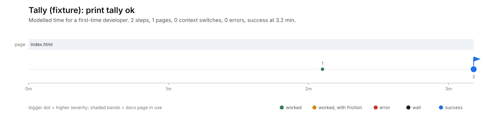

# Tally (fixture): developer experience audit

**Goal:** print tally ok  
**Success means:** prints 'tally ok'  
**Docs:** file://~/docs%20site/index.html  
**Environment:** Linux fixture  
**Date:** 2026-11-13

## Summary

TODO: three or four sentences. Did a new developer reach the goal, how long did it take, where did it hurt most, and what one change would help most.

| Metric | Result |
|---|---|
| Reached the goal | Yes |
| Time to first success (modelled, first-time developer) | 3.2 min |
| Time to first success (agent wall clock) | 0.0 min |
| Steps to success | 2 (1 commands) |
| Docs pages visited / context switches | 1 / 0 |
| Had to leave the docs for | nothing |
| Errors before success | 0 |
| Signup or key walls | 0 |
| Lines of code written | 0 |
| Friction points (sev 1 / 2 / 3) | 1 (1 / 0 / 0) |
| Error message quality | not graded |

## The journey

| # | Min | Page | What I did | Result | Friction |
|---|---|---|---|---|---|
| 1 | 2.1 | [index.html](index.html) | Open the quickstart | ok |  |
| 2 | 3.2 | [index.html](index.html) | Run the snippet: `python -c ...` | success | dead-link (sev 1) |

TODO: under the table, tell the story in a few short paragraphs. Quote the exact error text where it matters and link the screenshots in `screenshots/`.

## Friction found

- **#2 dead-link, severity 1 (annoying).** Next link is a 404 in the fixture Fix: Link to configuration.html

## Error messages

Each mistake was made on purpose. Grades: does the message say what happened, why, and how to fix it (0 to 2 each).

| Mistake | What | Why | Fix | Grade |
|---|---|---|---|---|
## Top 5 fixes

Ranked by impact (how many people it saves, and how much time) over effort (how much work for the team).

| # | Fix | Impact | Effort |
|---|---|---|---|
| 1 | TODO | High/Med/Low | S/M/L |
| 2 | TODO | High/Med/Low | S/M/L |
| 3 | TODO | High/Med/Low | S/M/L |
| 4 | TODO | High/Med/Low | S/M/L |
| 5 | TODO | High/Med/Low | S/M/L |

TODO: for each fix, a short section with the current text, the problem in one sentence, and the rewritten doc snippet or error message, ready to paste.

## What they do well

TODO: specific things that worked, with the step number. Name what to keep so the fixes don't break it.

## Method

Fresh empty folder, no prior knowledge used beyond the official docs, docs followed literally in order. Modelled time charges each new docs page at 238 words a minute (at most 6 minutes a page), 20 s to copy and run each command plus its run time, 15 s per line of code, and 1 min, 1.5 min, 4 min, 10 min to work through a failure of severity 0, 1, 2 and 3. Raw log: `friction.json`. Command output: `outputs/`. Page captures: `snapshots/` and `screenshots/`.
